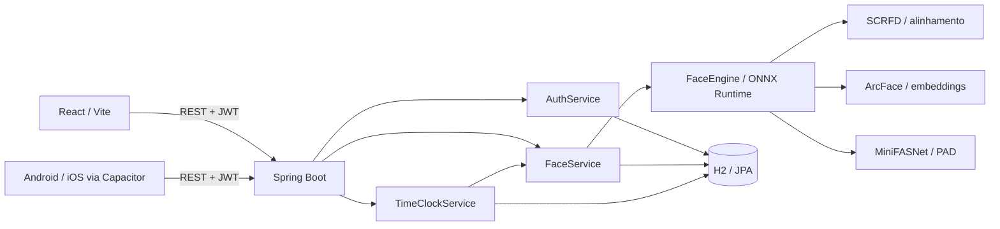

# Ulisses · Biometria facial por vídeo


Aplicação full stack para cadastrar e comparar rostos com inferência no próprio backend. Reúne **Java/Spring Boot, React, ONNX Runtime e Capacitor**, com captura guiada pela câmera e uma demonstração de registro de entrada/saída por verificação facial.

**Status:** projeto experimental de portfólio. Há testes das regras de negócio, do contrato de entrada dos modelos e do cliente HTTP. A eficácia biométrica ainda precisa de avaliação com dados reais; o projeto não é uma solução antifraude certificada nem um sistema de ponto homologado.

[Revisão técnica e prioridades](docs/REVISAO_TECNICA.md) · [Roteiro de testes e publicação](docs/TESTES_E_PUBLICACAO.md) · [Contribuição](CONTRIBUTING.md) · [Segurança](SECURITY.md)

## O que o projeto demonstra

- API REST organizada por domínio, autenticação JWT e senhas com BCrypt.
- Pipeline local de detecção SCRFD, alinhamento facial e embeddings ArcFace.
- Desafios de movimento de uso único e classificação passiva de apresentação facial com MiniFASNet.
- Criptografia AES-GCM dos templates quando configurada, obrigatória no perfil `prod`.
- Frontend responsivo, temas claro/escuro e projetos Android/iOS a partir da mesma interface.
- Testes automatizados, builds Docker em múltiplos estágios e GitHub Actions.

O fluxo é: **criar conta → cadastrar o rosto em três poses → executar uma verificação → consultar o histórico ou registrar ponto**. A identidade fica associada à conta criada pelo próprio usuário; não há validação documental dessa identidade.

## Interface

| Login | Início |
|:---:|:---:|
|  |  |

| Tema escuro | Mobile |
|:---:|:---:|
|  |  |

As imagens acima são capturas já presentes no repositório. Para avaliar o comportamento da câmera e da prova de vida, execute o [roteiro manual](docs/TESTES_E_PUBLICACAO.md). Não há vídeo demonstrativo publicado neste README.

## Executar com Docker

Requisitos: Git e Docker com Compose. Na primeira inicialização, o backend baixa os modelos ONNX; aguarde o log `Engine de reconhecimento facial pronta`. O tamanho e o tempo do download dependem dos artefatos e da conexão.

```bash
git clone https://github.com/JonnasFigueiredo/Ulisses.git
cd Ulisses
cp .env.example .env
```

No PowerShell, use `Copy-Item .env.example .env`. **Se já existe um `.env`, preserve-o.** Preencha `ULISSES_JWT_SECRET` e `ULISSES_CRYPTO_KEY` com dois segredos independentes. Para gerar cada valor:

```bash
openssl rand -hex 32
```

Alternativa no PowerShell, executada uma vez para cada segredo:

```powershell
$bytes = New-Object byte[] 32
$rng = [System.Security.Cryptography.RandomNumberGenerator]::Create()
$rng.GetBytes($bytes)
$rng.Dispose()
[BitConverter]::ToString($bytes).Replace('-', '').ToLowerInvariant()
```

Cole os valores somente no `.env`, que está ignorado pelo Git. Então:

```bash
docker compose up --build -d
docker compose logs -f backend
```

Abra **http://localhost:5173**. As portas são publicadas apenas em `127.0.0.1` por padrão. O Compose exige os segredos, e o backend rejeita valores vazios, curtos ou exemplos conhecidos no perfil `prod`.

**Se há templates cadastrados, não substitua a chave de criptografia sem planejar uma migração:** os dados existentes dependem da chave anterior. Remover um valor de exemplo da configuração não recriptografa os dados antigos.

Os scripts `run.cmd` e `bash run.sh` oferecem `docker`, `dev`, `build`, `logs` e `stop`. Configure o `.env` antes do modo Docker. A abertura automática do navegador não significa que os modelos já terminaram de carregar.

## Desenvolvimento

Use **JDK 21** e **Node.js 22+**; `.nvmrc` indica a versão usada no CI. Confira também `JAVA_HOME`. O Capacitor 8 requer Node 22 ou superior ([requisitos oficiais](https://capacitorjs.com/docs/updating/8-0)).

Backend, dentro de `backend/`:

```bash
sh mvnw spring-boot:run
# PowerShell: .\mvnw.cmd spring-boot:run
```

Frontend, em outro terminal, dentro de `frontend/`:

```bash
npm ci
npm run dev
```

Frontend em **http://localhost:5173**, API em **http://localhost:8080**. O Vite encaminha `/api` ao backend. Para acessar pelo navegador do celular na rede local, use `npm run dev:mobile`, que habilita HTTPS com certificado de desenvolvimento.

O `.env` da raiz é lido pelo **Docker Compose**. Na execução nativa, exporte as variáveis no terminal; o Spring Boot não carrega esse arquivo automaticamente. Sem `prod`, o ambiente permite configurações de desenvolvimento, inclusive console H2 e templates sem criptografia quando nenhuma chave é fornecida. Mantenha esse modo restrito ao ambiente local.

## Arquitetura e decisões



| Decisão | Benefício | Limite atual |
|---|---|---|
| Monólito com módulos por domínio | Execução e navegação do código simples | `FaceService` concentra regras demais e deve ser dividido gradualmente |
| Inferência no backend | Dispensa serviço externo de reconhecimento durante a operação | CPU, memória e concorrência precisam ser medidas |
| H2 em arquivo | Instalação local simples | Persistência e migrações precisam evoluir para hospedagem duradoura |
| Captura por frames | Compartilha o fluxo entre web e mobile | Não autentica a origem da câmera nem comprova captura ao vivo |
| Desafios em memória | Implementação simples de uso único e expiração | Reinícios invalidam desafios; múltiplas réplicas exigem estado compartilhado |

Os frames são enviados ao backend configurado. A inferência não usa uma API externa. Os modelos são baixados de terceiros na inicialização e reutilizados em disco; as imagens não são persistidas pelo fluxo de cadastro/verificação, mas os templates e históricos são.

## Testes

```bash
# Dentro de backend/
sh mvnw verify
# Windows: .\mvnw.cmd verify

# Dentro de frontend/
npm ci
npm test
npm run build
npm audit
```

Os testes de serviço usam embeddings e poses controlados. Eles verificam regras e regressões, **não medem reconhecimento ou resistência a fraude no mundo real**. Os testes do frontend cobrem HTTP e lógica de captura com câmera simulada; não substituem testes em navegadores e dispositivos.

O CI executa backend, frontend e builds de imagens e iOS. O projeto Android está no repositório, mas ainda não tem job de build no CI. Consulte no relatório os comandos efetivamente executados e as validações pendentes.

## Modelos e calibração

| Componente | Uso no projeto |
|---|---|
| SCRFD / InsightFace `buffalo_l` | Localizar rosto e landmarks |
| ArcFace / `w600k_r50` | Gerar embeddings de 512 dimensões |
| MiniFASNet V2 + V1SE | Classificação passiva com dois recortes |

A configuração está em `backend/src/main/resources/application.yml`. Os limiares `match-threshold: 0.45` e `passive-liveness.threshold: 0.55` são **valores experimentais**. Não há resultado medido neste repositório que associe esses números a uma taxa de falsa aceitação ou a certificação FIDO/ISO.

Para os modelos MiniFASNet configurados, a entrada é **BGR float32 em 0–255**, layout CHW, e a classe viva é **1**, conforme o [código de inferência do fornecedor](https://github.com/yakhyo/face-anti-spoofing/blob/main/onnx_inference.py). O índice pertence ao contrato do modelo; não deve ser escolhido para aumentar a taxa de aprovação.

O avaliador experimental `PadEvaluationTest` recebe `-Dpad.dataset=/caminho/dataset -Dpad.models=./models`, com imagens em `bonafide/` e `attack/`. Ele é ignorado quando não há dataset. Antes de usar suas métricas como evidência, trate os casos sem rosto, exija amostras em ambas as classes e separe calibração de validação, conforme a revisão técnica.

## Limites de segurança

- Não há certificação de PAD nem benchmark próprio de FMR/FNMR.
- Sequências de frames podem ser fabricadas ou extraídas de vídeos; a validação das fases não prova a origem ao vivo.
- O cadastro pode ser substituído pelo titular autenticado sem uma segunda autenticação forte.
- Rate limiting, concorrência, retenção e proteção do cadastro público ainda precisam de reforço antes de uma demonstração aberta na internet.
- JWT fica no `localStorage`; a configuração mobile permite HTTP para laboratório. Use HTTPS na publicação e revise o build mobile de distribuição.

Veja os [bloqueadores para publicação e testes manuais](docs/TESTES_E_PUBLICACAO.md). O perfil `prod` reforça a configuração, mas não resolve todas essas limitações.

## API

| Método | Rota | Função |
|---|---|---|
| POST | `/api/auth/register` | Criar conta |
| POST | `/api/auth/login` | Autenticar |
| GET | `/api/auth/me` | Consultar sessão |
| GET | `/api/face/status` | Estado dos modelos e do cadastro |
| POST | `/api/face/enroll` | Cadastrar frames e fases |
| POST | `/api/face/pose` | Orientar posicionamento |
| POST | `/api/face/challenge` | Gerar desafio |
| POST | `/api/face/verify` | Verificar frames, fases e desafio |
| DELETE | `/api/face/enrollment` | Excluir templates |
| GET | `/api/face/history` | Consultar últimas verificações |
| POST | `/api/timeclock/punch` | Verificar rosto e registrar entrada/saída |
| GET | `/api/timeclock/today` | Consultar registros do dia |

As rotas de autenticação são públicas; as demais exigem `Authorization: Bearer <token>`. O formato multipart usa `frames`, `phases` e, na verificação, `challengeId`. A checagem de pose usa `frame`.

## Aplicativos mobile

Depois de `npm ci` e `npm run build` em `frontend/`, execute `npx cap sync android` ou `npx cap sync ios`. Android pode ser aberto no Android Studio; para gerar o APK de desenvolvimento no Windows, execute `.\gradlew.bat assembleDebug` em `frontend/android/`.

iOS exige macOS e Xcode compatível com Capacitor 8; use `npx cap open ios`. Build de simulador sem assinatura não valida câmera em dispositivo nem equivale a um aplicativo pronto para distribuição. No app, informe a URL do backend em **Servidor Ulisses**.

## Licenças

O código do Ulisses é [MIT](LICENSE). Isso não altera as licenças dos modelos. O [model zoo oficial do InsightFace](https://github.com/deepinsight/insightface/blob/master/python-package/docs/model_zoo.md) restringe os modelos pré-treinados a pesquisa não comercial; verifique autorização antes de adotar ou redistribuir os pesos. Trocar um ONNX exige compatibilidade de entrada/saída e nova validação, além de ajustar a URL.

A implementação original [Silent-Face-Anti-Spoofing](https://github.com/minivision-ai/Silent-Face-Anti-Spoofing) e a exportação utilizada têm seus próprios avisos de licença. Preserve-os e revise os termos dos artefatos efetivamente distribuídos.
