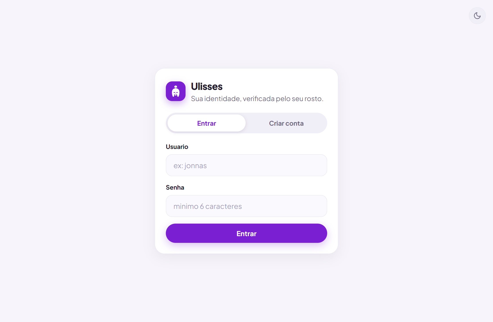
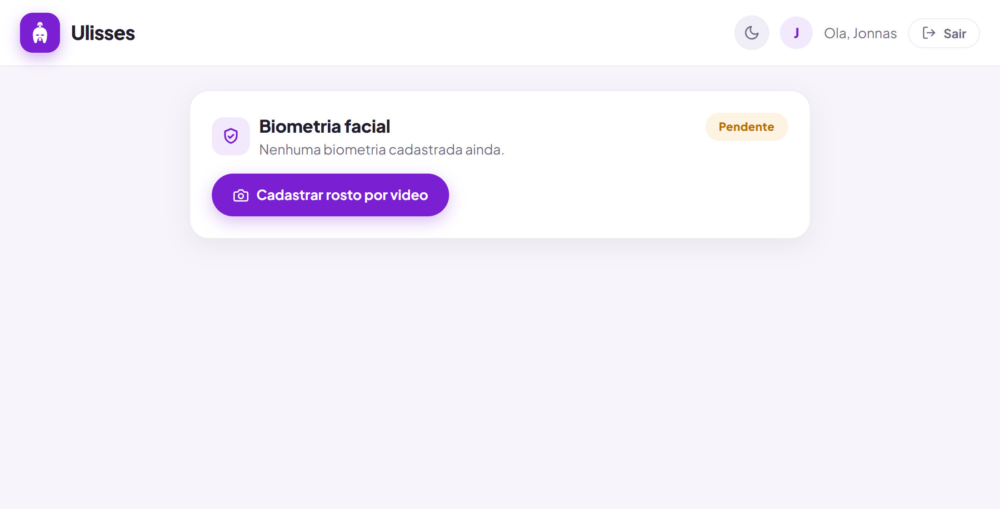
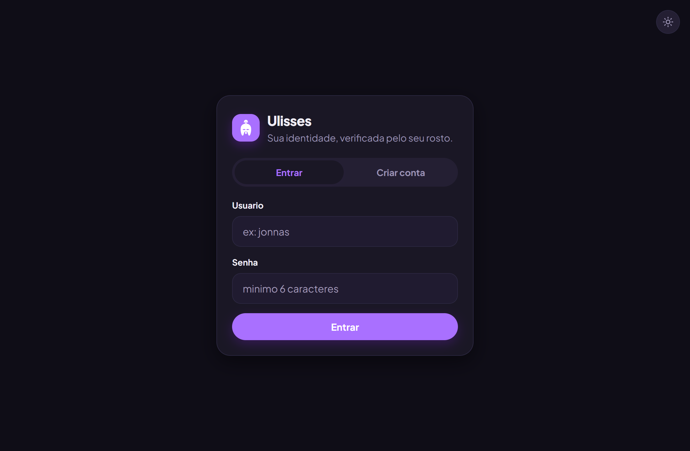
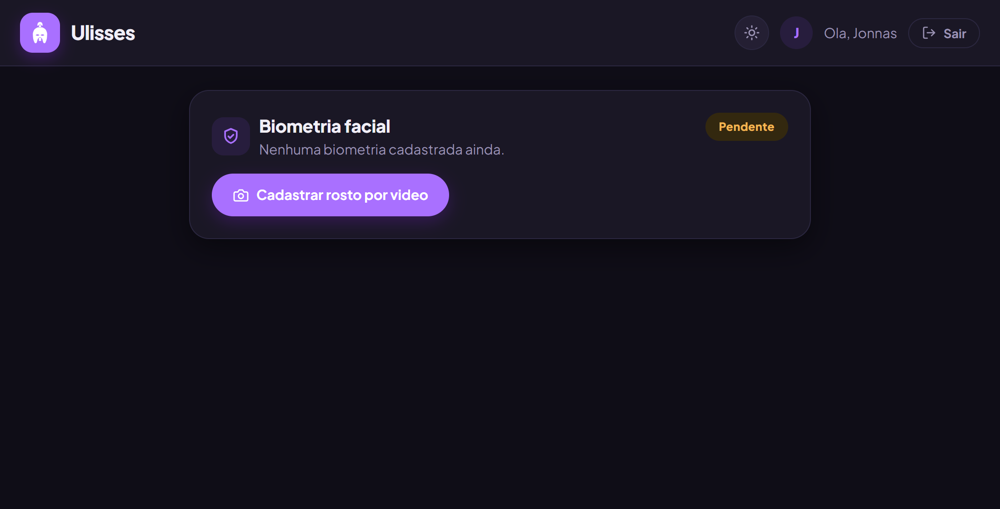
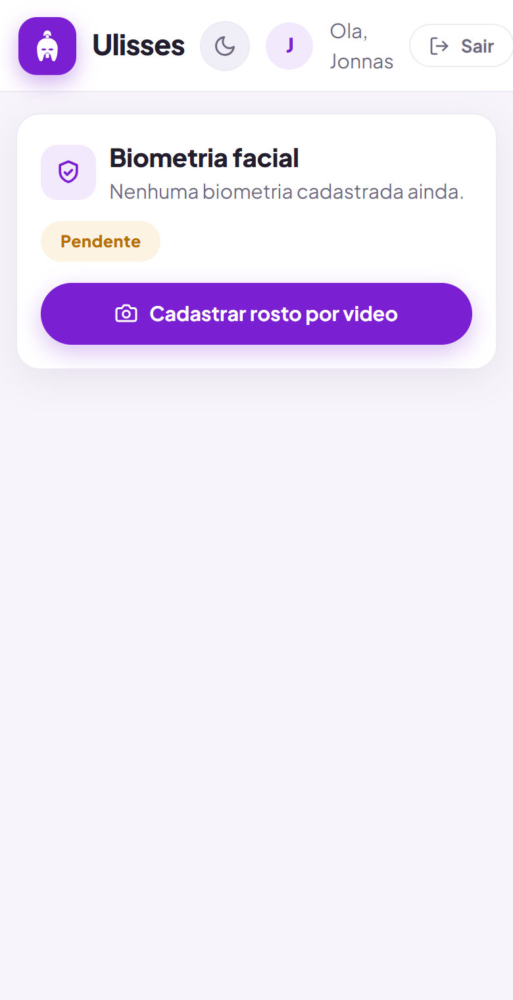
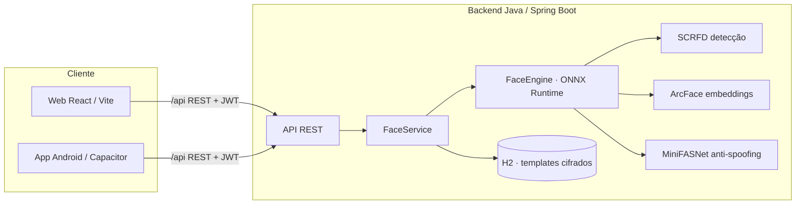

# Ulisses · Biometria Facial por Vídeo


Cadastro e validação de biometria facial por vídeo, com **reconhecimento 100% local** — nenhuma imagem sai da sua infraestrutura. Pensado como um bloco funcional que empresas podem hospedar por conta própria, com prova de vida (ativa + anti-spoofing), tema claro/escuro e app Android.

> ⚠️ **Antes de usar comercialmente, leia [Licenças dos componentes](#licenças-dos-componentes) e o [Checklist de produção](#checklist-de-produção).** O código é MIT, mas os modelos padrão de detecção/reconhecimento têm licença de uso não-comercial.

## Início rápido (Docker)

Sobe backend + frontend com um comando:

```bash
git clone https://github.com/JonnasFigueiredo/Ulisses.git
cd Ulisses
docker compose up --build
```

Abra **http://localhost:5173** (a câmera funciona em `localhost` sem HTTPS). No primeiro start o backend baixa os modelos ONNX (~185 MB) uma única vez. Para produção, `cp .env.example .env` e defina segredos fortes antes de subir.

## Demonstração

> 🎥 **Vídeo do funcionamento — cadastro e validação facial ao vivo**
>
> <!-- COMO ADICIONAR O VÍDEO:
>      1. Edite este README pelo site do GitHub (ou abra uma issue), arraste o arquivo de vídeo
>         para o editor e o GitHub gera um link https://github.com/user-attachments/assets/...
>      2. Cole esse link no lugar da linha abaixo. -->
>
> _🚧 Espaço reservado para a demonstração em vídeo (cadastro por vídeo + validação com prova de vida)._

### Telas

| Login | Início |
|:---:|:---:|
|  |  |

**Tema claro/escuro** (respeita a preferência do sistema) e layout **responsivo**:

| Login (escuro) | Início (escuro) | Mobile |
|:---:|:---:|:---:|
|  |  |  |

> As telas de **captura por vídeo** (cadastro e validação, com o oval-guia, a prova de vida e o
> anti-spoofing em ação) aparecem no vídeo acima — elas exigem câmera ao vivo.

## Como funciona

| Etapa | Tecnologia |
|---|---|
| Detecção facial + landmarks | **SCRFD (det_10g)** — detector do InsightFace, estado da arte em detecção facial |
| Alinhamento facial | Transformação de similaridade (**Umeyama**) para o template canônico 112×112 |
| Reconhecimento | **ArcFace (w600k_r50)** — embeddings de 512 dimensões, comparados por similaridade de cosseno |
| Prova de vida ATIVA | **Desafio ativo duplo em 4 direções**: o servidor sorteia DOIS movimentos de cabeça entre **esquerda, direita, cima e baixo** (yaw + pitch, geometria dos 5 landmarks contra a linha de base do próprio usuário) que precisam ser executados ao vivo, na ordem — vídeo gravado tem **1 chance em 16 (~6%)**; desafio de uso único, expira em 2 minutos, com **análise de trajetória por eixo** (movimento contínuo, sem saltos de troca de foto/vídeo) e verificação de identidade contínua durante os movimentos |
| Prova de vida PASSIVA | **Anti-spoofing por textura** via ensemble **MiniFASNet** (Silent-Face, Apache-2.0): segunda camada que analisa a textura ao redor do rosto para detectar foto impressa ou tela. Roda local, junto do reconhecimento. **Precisa ser calibrado/validado** (ver seção de PAD abaixo) |
| Captura guiada por pose | Durante cadastro e validação, cada frame passa por checagem de pose em tempo real (`/api/face/pose`); a captura **só avança quando o usuário executa a pose pedida**, e o servidor revalida os giros no ato do cadastro |
| Qualidade e antifraude | Nitidez mínima por variância do Laplaciano (descarta frames borrados), rejeição de frames com **mais de uma pessoa** no quadro, e **rate limiting** de 6 validações/minuto por usuário |
| Inferência | **ONNX Runtime** rodando em CPU, embarcado no backend Java |

### Arquitetura



Fluxo do usuário: criar conta / login → **cadastro facial por vídeo** (captura guiada em 3 poses) → **validação por vídeo** com prova de vida.

- Os modelos ONNX (~180 MB) são baixados automaticamente **uma única vez** no primeiro start do backend, para a pasta `backend/models/`. Depois disso o sistema funciona offline.
- Backend: Java 21 + Spring Boot 3.5 (JWT, JPA/H2). Frontend: React 18 + Vite, responsivo (webcam no desktop, câmera frontal no celular), com **tema claro/escuro** (respeita a preferência do sistema e permite alternar).
- Identidade visual: o ícone é um **elmo coríntio** (capacete do herói grego que dá nome ao sistema). As artes-fonte ficam em `frontend/assets/`; os ícones do Android são gerados com `npx @capacitor/assets generate --android`.

## Rodando em desenvolvimento

Para desenvolvimento sem Docker (requer **JDK 21** e **Node.js 18+**):

### Backend

```bash
cd backend
./mvnw spring-boot:run          # Linux/macOS/Git Bash
mvnw.cmd spring-boot:run        # Windows (cmd/PowerShell)
```

Sobe em `http://localhost:8080`. No primeiro start, aguarde o log `Engine de reconhecimento facial pronta`.

### Frontend

```bash
cd frontend
npm install
npm run dev
```

Sobe em `https://localhost:5173` (HTTPS com certificado autoassinado — aceite o aviso do navegador). As chamadas `/api` são proxeadas para o backend automaticamente.

### Usando no celular (navegador)

1. Rode o frontend com `npm run dev:mobile` (HTTPS com certificado autoassinado).
2. Conecte o celular na mesma rede Wi-Fi do computador.
3. O Vite exibe no terminal o endereço de rede (ex.: `https://192.168.0.10:5173`) — abra-o no navegador do celular e aceite o certificado. O HTTPS é obrigatório: navegadores só liberam a câmera em contexto seguro.

### Aplicativo Android (APK)

O projeto inclui um app nativo via **Capacitor** em `frontend/android/`. Para gerar o APK:

```bash
cd frontend
npm run build && npx cap sync android
cd android && gradlew.bat assembleDebug
```

O APK sai em `frontend/android/app/build/outputs/apk/debug/app-debug.apk`. Instale no celular (transferindo o arquivo ou via `adb install`).

**Para usar o app:**
1. Deixe o backend rodando no computador (`mvnw spring-boot:run`).
2. Descubra o IP do computador na rede (`ipconfig` → IPv4) e libere a porta 8080 no Firewall do Windows se necessário.
3. No app, com o celular na mesma rede Wi-Fi, preencha o campo **Servidor Ulisses** na tela de login, ex.: `http://192.168.0.10:8080`.

No app a câmera funciona sem HTTPS (o WebView do Capacitor roda em contexto seguro) e a permissão de câmera é pedida no primeiro uso.

## Calibração e padrões globais

O sistema segue os referenciais internacionais de biometria facial:

- **Decisão 1:1 (FIDO Biometrics / NIST FRVT)** — a aceitação usa a **mediana** da similaridade de cosseno dos frames frontais contra os templates (mediana é robusta a frames atípicos). O limiar padrão `0.45` opera com taxa de falsa aceitação (FMR) na ordem de **1:100.000**, com folga sobre o requisito FIDO de 1:10.000. Pontos de operação: `0.38` conveniência (~1:1.000) · `0.42` equilibrado (~1:10.000, requisito FIDO) · `0.45` recomendado · `0.50` alta segurança. Os valores exatos de FMR variam com população e condições de captura.
- **Qualidade de cadastro (ISO/IEC 19794-5)** — os frames frontais do cadastro exigem **distância interocular ≥ 60 px**, garantindo resolução suficiente do template; a interface orienta o usuário a se aproximar da câmera quando necessário.
- **Prova de vida ativa (ISO/IEC 30107)** — desafio dinâmico de uso único sorteado pelo servidor; o **movimento é verificado como observado ao vivo** (a captura precisa partir do rosto centralizado e transitar até o desvio pedido — ver abaixo), com verificação de identidade contínua durante o movimento.

## Modelo de ameaça e limites honestos da prova de vida

O sistema foi endurecido a partir de uma **revisão adversarial** (o relatório e as correções estão no histórico de commits). O que a prova de vida ativa **garante** e o que **não** garante:

**Defesas implementadas (server-side, não confiam no cliente):**
- **Movimento observado ao vivo:** cada movimento do desafio precisa conter um frame com o rosto **centralizado** (neutro) *antes* de atingir o desvio pedido, com trajetória contínua. Isso derruba o ataque mais barato — **rotular fotos já viradas do alvo como "giro"** (uma foto estática nunca tem o frame neutro + a transição).
- **Baseline validada no servidor:** a pose frontal de referência é checada como realmente frontal (yaw e pitch), então o atacante não pode enviesar o referencial.
- **Desafio 2-de-4 direções distintas** (esquerda/direita/cima/baixo), uso único, expira em 2 min; **identidade por mediana** também durante o movimento; resolução mínima e nitidez exigidas; **rejeição de múltiplos rostos**; **rate limiting** em `verify`, `challenge` e `pose`; teto de frames por requisição.

**Limite fundamental (seja honesto ao apresentar):** por ser uma arquitetura de **upload de frames** (o cliente envia imagens, não um stream ao vivo autenticado), um atacante que possua o **JWT do titular + um vídeo do titular executando os movimentos** ainda pode, teoricamente, recortar os trechos correspondentes ao desafio. Fechar isso de vez exige uma das duas coisas, que **não** são código de aplicação e estão documentadas como evolução:
1. **Canal em tempo real** (WebRTC) com *nonce por frame* emitido pelo servidor no momento do desafio, atando cada frame àquela sessão;
2. **PAD certificado ISO/IEC 30107-3** (laboratório iBeta), que detecta a textura de tela/replay independentemente do movimento.

Além disso, o **cadastro (`enroll`) não exige prova de vida** — quem tem a sessão pode re-cadastrar a própria biometria; trate o cadastro como operação sensível com reautenticação forte em produção.

## Prova de vida passiva (anti-spoofing) e calibração

O sistema tem **duas camadas de liveness**: a ativa (giro de cabeça, já validada e determinística) e a passiva (anti-spoofing por textura, MiniFASNet). A passiva é uma aproximação séria do que se espera de um sistema antifraude, mas com uma ressalva honesta e importante:

> ⚠️ **Isto NÃO é uma solução certificada ISO/IEC 30107-3.** A certificação é feita por laboratório acreditado (ex.: iBeta), com instrumentos de ataque padronizados, e não pode ser substituída por código. A camada passiva aqui **precisa ser calibrada e ter a eficácia validada contra um dataset real de ataques** antes de ser tratada como proteção confiável.

### Harness de medição (ISO/IEC 30107-3)

O projeto inclui um avaliador que calcula as métricas oficiais — **APCER** (ataques aceitos como reais), **BPCER** (reais rejeitados) e **ACER** (média) — varrendo limiares para encontrar o ponto ótimo. Monte um dataset rotulado:

```
dataset/
  bonafide/   *.jpg   (rostos reais capturados ao vivo)
  attack/     *.jpg   (fotos impressas, telas/replay, máscaras, etc.)
```

E rode:

```bash
cd backend
mvnw test -Dtest=PadEvaluationTest -Dpad.dataset=/caminho/do/dataset -Dpad.models=./models
```

Ele imprime a tabela APCER/BPCER/ACER por limiar e sugere o melhor `threshold`. Ajuste então `ulisses.face.passive-liveness.threshold` (e, se necessário, `live-class-index`) conforme o resultado. **Enquanto não calibrado com dados reais, trate a camada passiva como "melhor esforço", não como garantia.**

### Caminhos de evolução (análise honesta)

O pipeline atual (SCRFD → Umeyama → ArcFace → cosseno) é o mesmo padrão dos melhores projetos
abertos (CompreFace, immich); as evoluções relevantes não são trocas de código às cegas, e sim:

- **Reconhecimento com licença comercial livre:** trocar o ArcFace `buffalo_l` (não-comercial) por
  **AdaFace** (código MIT) é o caminho natural — a arquitetura já é plugável (URL do ONNX em
  `application.yml`); a troca exige apenas ajustar a normalização de entrada e **validar com um
  benchmark de pares** antes de adotar (nunca troque o modelo sem medir).
- **PAD certificado:** para grau bancário, integrar um SDK de liveness certificado ISO 30107-3
  (iBeta nível 1/2) no lugar/ao lado do MiniFASNet.
- **Landmarks densos (piscar/expressão):** exigiria um modelo adicional de 68/106 pontos com
  licença adequada; o ganho é incremental frente ao desafio de 4 direções + PAD.

## Configuração

Principais chaves em `backend/src/main/resources/application.yml`:

| Chave | Padrão | Descrição |
|---|---|---|
| `ulisses.face.match-threshold` | `0.45` | Limiar de decisão 1:1 (ver tabela de pontos de operação acima) |
| `ulisses.face.min-detection-score` | `0.60` | Confiança mínima da detecção para aproveitar um frame |
| `ulisses.face.min-face-size` | `80` | Tamanho mínimo do rosto em pixels |
| `ulisses.face.min-enroll-interocular` | `60` | Distância interocular mínima (px) nos frames frontais do cadastro |
| `ulisses.face.min-sharpness` | `40` | Nitidez mínima do rosto alinhado (variância do Laplaciano) |
| `ulisses.face.passive-liveness.enabled` | `true` | Liga a camada de anti-spoofing por textura (MiniFASNet) |
| `ulisses.face.passive-liveness.threshold` | `0.55` | Score mínimo de liveness passiva (calibre com o harness) |
| `ulisses.face.passive-liveness.live-class-index` | `2` | Índice da classe "vivo" no softmax do modelo (calibre com o harness) |
| `ulisses.jwt.secret` | dev | Segredo JWT — **defina `ULISSES_JWT_SECRET` em produção** |
| `ulisses.crypto.key` | vazio | Chave AES-256-GCM dos templates — **defina `ULISSES_CRYPTO_KEY` em produção** |
| `ulisses.cors.allowed-origins` | `*` | Origens do CORS — **restrinja via `ULISSES_CORS_ORIGINS` em produção** |

Console do H2 (apenas dev): `http://localhost:8080/h2-console` — JDBC `jdbc:h2:file:./data/ulisses`, usuário `sa`, senha vazia. **Desligado no perfil `prod`.**

## Checklist de produção

O padrão do repositório é voltado a desenvolvimento. Para produção, ative o perfil `prod`
(`SPRING_PROFILES_ACTIVE=prod`) e defina as variáveis de ambiente — a aplicação **não sobe** sem elas:

| Item | Como |
|---|---|
| Segredo JWT forte | `ULISSES_JWT_SECRET` (ex.: `openssl rand -hex 32`) |
| Criptografia dos templates em repouso | `ULISSES_CRYPTO_KEY` — cifra AES-256-GCM (obrigatória no prod) |
| CORS restrito | `ULISSES_CORS_ORIGINS` com as origens exatas do seu frontend/app |
| Console H2 desligado | automático no perfil `prod` |
| Licença dos modelos | resolver o uso comercial (ver abaixo) |
| Prova de vida passiva | calibrar/validar com o harness antes de confiar como antifraude |
| Banco | H2 embutido serve para começar; para escala, migre para Postgres + Flyway |
| HTTPS | termine TLS num proxy reverso à frente do frontend/backend |

O `docker-compose.yml` já sobe com o perfil `prod`; troque os valores de `.env` antes de expor.

## Licenças dos componentes

O **código deste repositório é [MIT](LICENSE)**. Os modelos de IA embutidos têm licenças próprias
que o adotante precisa respeitar:

| Componente | Licença | Uso comercial |
|---|---|---|
| Código do Ulisses (backend + frontend) | MIT | ✅ Livre |
| Anti-spoofing **MiniFASNet** (Silent-Face) | Apache-2.0 | ✅ Livre |
| Detecção **SCRFD** + Reconhecimento **ArcFace** (InsightFace `buffalo_l`) | Não-comercial (pesquisa) | ⚠️ **Requer licença** |

> Os modelos `buffalo_l` (SCRFD + ArcFace) são liberados pela InsightFace **apenas para pesquisa/uso
> não-comercial**. Para uso comercial, obtenha uma licença com a InsightFace
> (`recognition-oss-pack@insightface.ai`) **ou** substitua por um modelo de detecção/reconhecimento
> com licença compatível. A arquitetura é agnóstica ao modelo — basta apontar outro ONNX em
> `application.yml`.

## API

| Método | Rota | Descrição |
|---|---|---|
| `POST` | `/api/auth/register` | Cria conta e retorna JWT |
| `POST` | `/api/auth/login` | Login |
| `GET` | `/api/face/status` | Situação da biometria do usuário |
| `POST` | `/api/face/enroll` | Cadastro facial (multipart: `frames[]` + `phases[]`) |
| `POST` | `/api/face/pose` | Checagem de pose em tempo real para guiar a captura (multipart: `frame`) |
| `POST` | `/api/face/challenge` | Sorteia o desafio de prova de vida |
| `POST` | `/api/face/verify` | Validação (multipart: `challengeId`, `frames[]`, `phases[]`) |
| `DELETE` | `/api/face/enrollment` | Remove a biometria |
| `GET` | `/api/face/history` | Últimas validações |

## Licença

Distribuído sob a licença [MIT](LICENSE).
